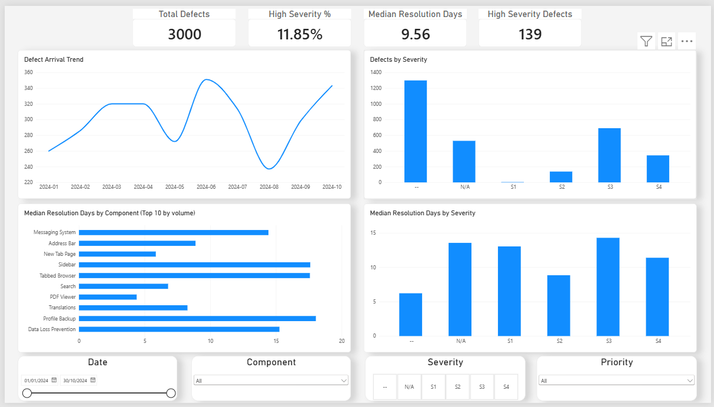

# Software Quality Verification Analytics

**Defect analytics, data-quality verification, and operational reporting using PostgreSQL, Microsoft SQL Server 2025, R, Python, and Power BI.**

This project uses **3,000 public Mozilla Firefox Bugzilla defects** as a proxy dataset for a software Quality Verification team. It builds a dimensional reporting model, checks data integrity, investigates defect-resolution patterns, and presents operational KPIs in Power BI. The original PostgreSQL implementation has also been **ported to Microsoft SQL Server (T-SQL)** and reconciled against the existing dashboard.

**Status:** Original analytics pipeline complete; SQL Server migration and Power BI reconnection verified locally (November 2026). See [`PROGRESS.md`](PROGRESS.md) for the original project log and [`sqlserver/README.md`](sqlserver/README.md) for migration details.

## At a glance

| Measure | Verified result |
| --- | ---: |
| Defects in the fixed dataset | **3,000** |
| Valid analytical records | **3,000** |
| Quarantined records | **0** |
| Data-quality checks | **7/7 passed** in the original workflow; SQL Server QA1–QA6 passed, QA7 reconciled manually |
| Power BI KPI reconciliation after SQL Server migration | **6/6 measures matched** at reported precision |
| Overall median resolution time | **9.56 days** |
| High-severity defects (S1 + S2) | **139** |
| High-severity share of classified defects | **11.85%** |

> **Denominator matters:** 11.85% is **139 / 1,173 severity-classified defects**, not 139 / 3,000. Records with severity `--` or `N/A` remain in overall reporting but are excluded from this rate and the high-vs-lower severity hypothesis test.

## Business problem

A Quality Verification team needs trustworthy answers to questions such as:

- How many defects arrive over time, and which components account for them?
- What share of severity-classified defects are high severity?
- How long do defects take to resolve, and how does that vary by component or severity?
- Why did an operational KPI change from one month to the next?
- Can the underlying SQL data, dimensional model, and dashboard metrics be reconciled?
- How might changing staffing affect a simulated backlog at a future ship date?

## Architecture

```text
Mozilla Bugzilla REST API
          |
          v
Frozen CSV snapshot: data/raw/firefox_bugs.csv (3,000 records)
          |
          +----------------------------+
          |                            |
          v                            v
PostgreSQL pipeline              SQL Server 2025 pipeline
sql/ (original)                 sqlserver/ (T-SQL port)
          |                            |
          +-------------+--------------+
                        |
                        v
          Staging -> cleaning -> quarantine
                        |
                        v
            Star schema: fact_bug
     dim_component | dim_severity | dim_priority | dim_date
                        |
              +---------+---------+
              |                   |
              v                   v
       SQL / R analysis        Power BI dashboard
              |                   |
              +---------+---------+
                        |
                        v
          Quality metrics and investigations

Separate Python extension: Monte Carlo backlog forecasting and backtesting
```

Both database implementations use the **same frozen input snapshot** and the same logical fact/dimension model. The original R hypothesis test and Python simulation are preserved; the SQL Server port was validated as an analytics/database migration, not as a claim that every downstream script was rerun against SQL Server.

## Dataset and modelling decisions

- **Source:** Public Mozilla Bugzilla REST API, collected with [`scripts/fetch_bugzilla_data.py`](scripts/fetch_bugzilla_data.py).
- **Snapshot:** 3,000 Firefox defects resolved as `FIXED`, with creation dates from **January 1 through October 30, 2024**.
- **Scope:** Only the selected public defect fields; no reporter emails, CC lists, or personal user IDs were collected.
- **Cleaning:** Five quarantine reasons are implemented: missing creation time, missing resolution time, negative duration, unknown severity code, and non-`FIXED` resolution.
- **Model:** `fact_bug` with four dimensions: `dim_component`, `dim_severity`, `dim_priority`, and `dim_date`.
- **Severity:** `S1`/`S2` = High; `S3`/`S4` = Lower; `--`/`N/A` = Unclassified. Unclassified records remain in overall counts and trends.

The main measures and transformation rules are documented in [`docs/methodology.md`](docs/methodology.md).

## Data pipeline and implementation

| Stage | PostgreSQL implementation | SQL Server implementation |
| --- | --- | --- |
| Create database | Set up `qa_project` | `sqlserver/00_create_database.sql` |
| Staging | `sql/01_create_staging.sql` | `sqlserver/01_create_staging.sql` |
| Import frozen CSV | PostgreSQL CSV import | `sqlserver/import_csv.py` (`pyodbc`) |
| Clean and quarantine | `sql/02_clean_transform.sql` | `sqlserver/02_clean_transform.sql` |
| Create dimensional model | `sql/03_create_star_schema.sql` | `sqlserver/03_create_star_schema.sql` |
| Load dimensions/facts | `sql/04_load_star_schema.sql` | `sqlserver/04_load_star_schema.sql` |
| Check data quality | `sql/05_qa_checks.sql` | `sqlserver/05_qa_checks.sql` |
| Analytical SQL | `sql/06_analysis_queries.sql` | `sqlserver/06_analysis_queries.sql` |
| Reporting | Power BI (PostgreSQL baseline) | Power BI (SQL Server source, Import mode) |

### SQL Server migration: what changed

The port is a working **T-SQL rewrite**, not just a connection-string change. It adapts PostgreSQL-specific features to SQL Server, including:

- `IDENTITY(1,1)` keys instead of `SERIAL`.
- `DATETIME2` and `DATEDIFF_BIG` for timestamp and duration calculations.
- Recursive CTEs for the calendar dimension instead of `generate_series()`.
- `PERCENTILE_CONT(...) OVER (...)` for median and P75 calculations.
- Conditional aggregation with `CASE` expressions, `TOP` queries, and SQL Server-compatible table loading.
- Windows-authenticated `pyodbc` CSV import, preserving UTC timestamp values and quoted CSV fields.

The original PostgreSQL scripts and statistical outputs were retained as the comparison baseline.

## Data quality and validation

The project uses **seven checks**. In the SQL Server script, QA1–QA5 are SQL anomaly counts, QA6 is SQL row reconciliation, and QA7 requires comparing SQL outputs against Power BI; QA7 does **not** pass automatically merely because the script executes.

| Check | Purpose | SQL Server result |
| --- | --- | --- |
| QA1 | Duplicate fact-table bug IDs | **0 anomalies** |
| QA2 | Negative resolution durations | **0 anomalies** |
| QA3 | Orphan dimension keys | **0 anomalies** |
| QA4 | Unknown severity codes | **0 anomalies** |
| QA5 | Reversed staging timestamps | **0 anomalies** |
| QA6 | `raw = valid + quarantined` | **PASS: 3,000 = 3,000 + 0** |
| QA7 | Reconcile SQL reporting metrics with Power BI | **6/6 matched**, manually confirmed at reported precision |

**QA7 comparison:** Total Defects; Median Resolution Days; Average Resolution Days; P75 Resolution Days; High Severity Defects; High Severity %. The migrated SQL Server-backed dashboard also retained its analytical visuals and slicers. This is a **metric-level reconciliation**, not a claim of byte-for-byte or row-by-row equality between database engines.

The confirmed headline values include **3,000 total defects**, **139 high-severity defects**, **11.85% high severity among classified defects**, and **9.56 median resolution days**. The average and P75 were also reported as matching during QA7, but their numeric values are not reproduced here.

## Power BI dashboard

The one-page dashboard contains:

- **Four KPI cards:** Total Defects, Median Resolution Days, High Severity Defects, High Severity %.
- **Four visuals:** defect arrival trend, severity mix, median resolution by top components, and median resolution by severity.
- **Four slicers:** date, component, severity, and priority.
- **Six DAX measures:** `Total Defects`, `Median Resolution Days`, `Average Resolution Days`, `P75 Resolution Days`, `High Severity Defects`, and `High Severity %`.

**Original dashboard:** [`powerbi/quality_verification_dashboard.pbix`](powerbi/quality_verification_dashboard.pbix). A **separate local copy** named `Software_Quality_SQLServer.pbix` was connected to SQL Server while preserving the original Power BI query names and existing visuals. If you publish the migrated PBIX, place it in `powerbi/` and add its repository link here.



## Statistical analysis (R)

A Wilcoxon rank-sum test compared resolution times for **high severity** (`S1` + `S2`) and **lower severity** (`S3` + `S4`) defects:

| Group | Defects | Median resolution |
| --- | ---: | ---: |
| High severity | 139 | 8.86 days |
| Lower severity | 1,034 | 13.61 days |

**Result:** `W = 58,544`, `p = 0.00038` (significant at α = 0.05). The high-severity group resolved faster in this snapshot, contrary to the initial expectation that more severe defects necessarily take longer. This is an **observed association, not evidence of causation**; prioritization is a possible explanation, not a proven cause.

The distributions are heavily right-skewed, which is why medians are more representative than means for the headline comparison. The test is in [`r/hypothesis_test.R`](r/hypothesis_test.R), with additional interpretation in [`docs/methodology.md`](docs/methodology.md).

## Root-cause investigation

Median resolution time rose from **8.47 days in April 2024 to 14.39 days in May** (**+69.9%**) before returning to **8.16 days in June**. Severity-mix changes moved in the wrong direction to explain the increase, and component-mix changes were too small. Several major components experienced higher medians simultaneously.

The finding is a **cross-component, time-based slowdown** compatible with a temporary capacity or release-related effect. The available data cannot identify its cause. See [`docs/root_cause_analysis.md`](docs/root_cause_analysis.md).

## Monte Carlo backlog simulation and backtest

The Python extension estimates open defects at a **90-day ship date**. Arrivals use **week-block resampling** to retain observed burstiness (daily arrival variance/mean **5.45**); service times are bootstrapped from observed resolution times. Staffing scenarios use an elasticity parameter `α` to illustrate diminishing returns.

- **Baseline forecast:** approximately **248** open defects at day 90 (P95 approximately **286**).
- **Staffing scenario:** 50% more staffing reduces the simulated backlog by **6%–19%**, depending on the assumed elasticity.
- **Rolling backtest:** four overlapping windows; mean absolute percentage error **7.7%** for the model versus **7.9%** for a naive persistence baseline — effectively a tie on point accuracy.
- **Uncertainty caveat:** all four outcomes fell inside the model's stated 95% ranges, but those ranges averaged about 36% of the point estimate, and four overlapping windows are **not sufficient to claim calibrated forecast intervals**.

The model lacks a trend term and is offered as a scenario-analysis tool, not an operationally validated forecasting system. See [`docs/simulation.md`](docs/simulation.md) and the Python files in `scripts/`.

## Run locally

### Option A — SQL Server 2025 + Power BI (tested migration)

**Prerequisites:** Windows, SQL Server 2025 Developer, SQL Server Management Studio (SSMS) 22, Python 3.12+, Microsoft ODBC Driver 18 for SQL Server, and Power BI Desktop. The tested instance was the default local SQL Server instance, accessed as `localhost` using Windows Authentication.

1. Clone the repository and open the project root in PowerShell. Keep the original 3,000-row CSV unchanged so published results remain comparable.
2. In SSMS, run **`sqlserver/00_create_database.sql`** followed by **`sqlserver/01_create_staging.sql`**.
3. From the repository root, install the CSV import dependency and import the snapshot:

   ```powershell
   python -m pip install pyodbc
   python sqlserver/import_csv.py --server localhost
   ```

4. Execute `sqlserver/02_clean_transform.sql`, `03_create_star_schema.sql`, `04_load_star_schema.sql`, `05_qa_checks.sql`, and `06_analysis_queries.sql` **in order**.
5. Confirm **3,000 staging rows, 3,000 fact rows, zero quarantined IDs, zero anomalies for QA1–QA5, and QA6 = PASS**.
6. Save a **copy** of the original Power BI `.pbix`. In Power Query's Advanced Editor, replace each original PostgreSQL `Source` and navigation with a SQL Server source, retaining the original query names and any further transformation steps. Example for the existing `public fact_bug` query:

   ```powerquery
   let
       Source = Sql.Database("localhost", "SQVA_SQLServer"),
       public_fact_bug = Source{[Schema="dbo", Item="fact_bug"]}[Data]
   in
       public_fact_bug
   ```

   Do the same for `dim_component`, `dim_severity`, `dim_priority`, and `dim_date`, each using schema `dbo` and its matching table. Apply, refresh, then verify the dashboard relationships, visuals, slicers, and all six KPI values against QA7 **without report filters**.

**Caution:** `01_create_staging.sql` drops/recreates the staging table; `03_create_star_schema.sql` drops/recreates the dimensional tables. Do not rerun them on a populated database unless intentionally rebuilding it. The importer also replaces the staging rows on execution. For setup details and troubleshooting, see [`sqlserver/README.md`](sqlserver/README.md).

### Option B — Original PostgreSQL pipeline

1. Install Python dependencies with `pip install -r requirements.txt`.
2. Use the committed `data/raw/firefox_bugs.csv` snapshot, or rerun `scripts/fetch_bugzilla_data.py` if intentionally creating a **new, non-comparable** dataset.
3. Set up PostgreSQL and execute the original `sql/01_create_staging.sql` through `sql/06_analysis_queries.sql` in the documented sequence, importing the CSV after creating staging.
4. Run `r/hypothesis_test.R` against the project's processed analytical dataset.
5. Open the original `powerbi/quality_verification_dashboard.pbix` with its PostgreSQL connection and refresh.
6. For the simulation extension, run:

   ```powershell
   python scripts/monte_carlo_backlog.py
   python scripts/monte_carlo_backtest.py
   ```

The original PostgreSQL instance used database `qa_project` on `localhost:5433`. Configure your own credentials locally; do not commit secrets.

## Repository structure

```text
Software_Quality_Verification_Analytics/
├── README.md
├── PROGRESS.md
├── .gitignore
├── requirements.txt
├── config/
├── data/
│   ├── raw/firefox_bugs.csv
│   └── processed/
├── scripts/
│   ├── fetch_bugzilla_data.py
│   ├── dataset.py
│   ├── monte_carlo_backlog.py
│   └── monte_carlo_backtest.py
├── sql/                          # Original PostgreSQL scripts (01–06)
├── sqlserver/                    # Microsoft SQL Server / T-SQL port
│   ├── README.md
│   ├── 00_create_database.sql
│   ├── 01_create_staging.sql
│   ├── import_csv.py
│   ├── 02_clean_transform.sql
│   ├── 03_create_star_schema.sql
│   ├── 04_load_star_schema.sql
│   ├── 05_qa_checks.sql
│   └── 06_analysis_queries.sql
├── r/hypothesis_test.R
├── powerbi/quality_verification_dashboard.pbix
├── docs/
│   ├── dashboard_user_guide.md
│   ├── methodology.md
│   ├── root_cause_analysis.md
│   ├── simulation.md
│   └── resume_bullets.md
└── images/dashboard.png
```

The separately saved SQL Server `.pbix` can be added under `powerbi/` before publishing; it is not assumed to be in the repository yet.

## Limitations

- The data is a **public Mozilla Firefox proxy**, not an internal quality dataset or a representative sample of an employer's workflow.
- Only **resolved-as-FIXED** defects are included, excluding open defects and introducing survivorship bias into resolution-time summaries.
- `resolution_days` is elapsed wall-clock time, not active engineering work time.
- About **61% of records lack classified severity** and are omitted from the severity comparison; `S1` appears only once, so the High group is dominated by `S2`.
- The Wilcoxon result and root-cause interpretation are observational; neither establishes causality.
- SQL Server validation establishes row counts, defined quality checks, and **matching reported KPI outputs**; it does not establish row-by-row binary equivalence or prove the port under different datasets.
- The backlog simulation's staffing elasticity is assumed, and its intervals have not been independently calibrated.

## Technologies

**Databases:** Microsoft SQL Server 2025, T-SQL, SSMS, PostgreSQL, SQL, star-schema modelling, relational integrity checks  
**Reporting and analytics:** Power BI, DAX, R, Wilcoxon rank-sum test, root-cause investigation  
**Data engineering and simulation:** Python, `pyodbc`, Pandas, Bugzilla REST API, CSV pipelines, Monte Carlo simulation  
**Workflow:** Git/GitHub, technical documentation, validation and reconciliation
